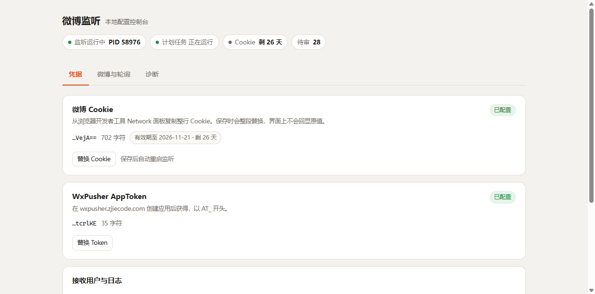
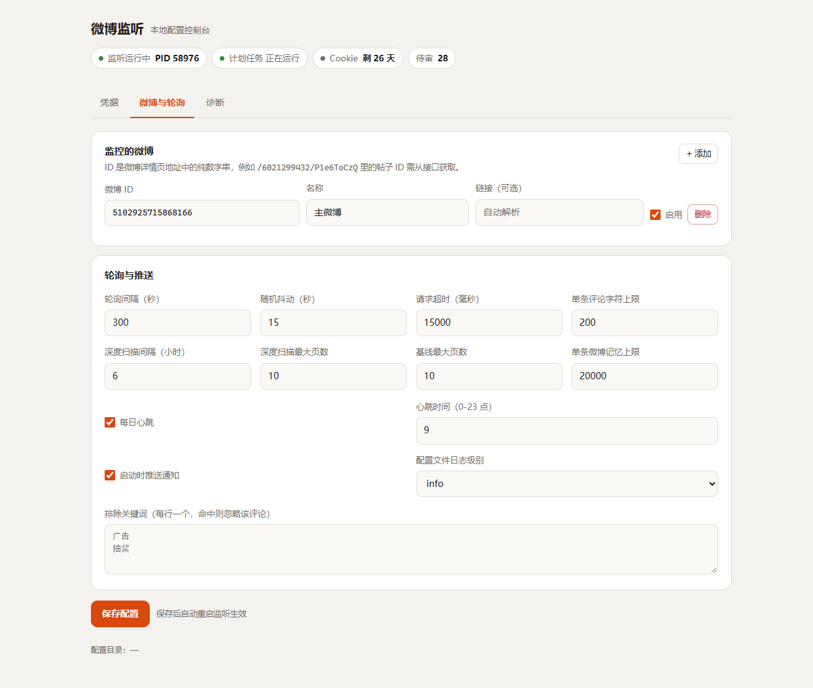
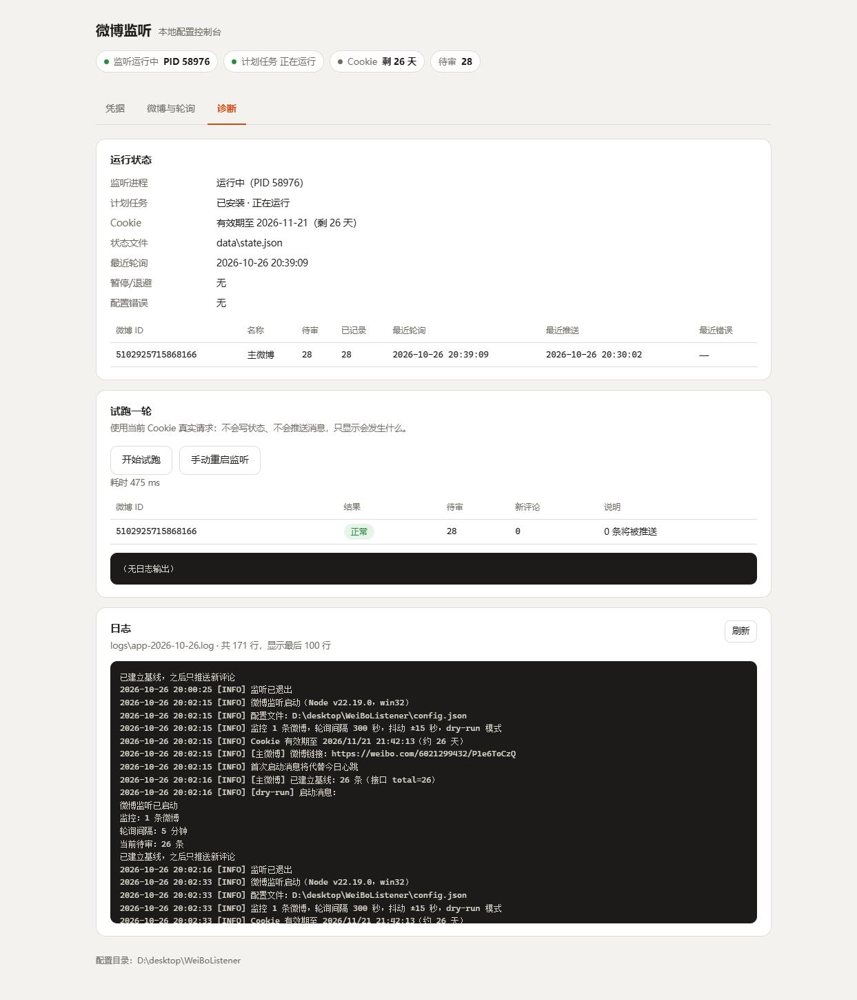

# 微博待审评论监听器

轮询指定微博的“待审评论”接口，发现新评论后通过 [WxPusher](https://wxpusher.zjiecode.com/) 推送到手机。

- 默认每 **5 分钟** 轮询一次，可自行修改
- 支持同时监听多条微博，状态互相独立
- 首次运行自动建立基线，不会把历史评论全部推一遍
- 支持排除关键词、Cookie 失效告警、每日心跳
- 零第三方依赖，Node.js 自带 `fetch`、`node --test`、`node --env-file`

## 环境要求

- Node.js **20.12+**（当前机器是 v22.19.0）
- 一个能访问 `weibo.com` 的网络
- WxPusher 的 `appToken` 和 `UID`

## 目录结构

```text
WeiBoListener/
├─ config.json           # 微博列表、轮询间隔、过滤规则
├─ .env                  # Cookie 和 WxPusher 密钥（不要提交/分享）
├─ .env.example          # 配置模板
├─ start.bat             # Windows 启动脚本（开发用）
├─ admin.bat             # 打开本地配置面板（开发用）
├─ run-hidden.vbs        # 任务计划用隐藏启动器（开发用）
├─ install-task.ps1      # 注册开机自启（开发用）
├─ uninstall-task.ps1    # 删除开机自启（开发用）
├─ build.ps1             # 打包脚本：产出 dist/（exe + app/）
├─ shell/launcher.cjs    # 打包版 exe 里的启动器（只负责加载 app/）
├─ packaging/            # 打包用的模板文件（首次使用说明等）
├─ src/                  # 程序代码
├─ test/                 # 单元测试
├─ data/state.json       # 运行后自动生成，保存已见评论
└─ logs/                 # 运行日志
```

## 第一次使用

### 1. 确认 `.env`

当前目录已经根据 `接口信息.txt` 生成了一个 `.env`，其中 `WEIBO_COOKIE` 已填好。你只需要补上 WxPusher 的两项：

```ini
WEIBO_COOKIE=...（已自动填入）
WXPUSHER_APP_TOKEN=AT_xxxxxxxx
WXPUSHER_UIDS=UID_xxxxxxxx
```

获取方式：

1. 打开 <https://wxpusher.zjiecode.com/>，微信扫码登录
2. 创建一个应用，复制 **appToken**
3. 用微信关注该应用的公众号，在“我的”页面复制 **UID**
4. 把 appToken 和 UID 填入 `.env`

> UID 有多个时用英文逗号分隔，例如 `UID_aaa,UID_bbb`。

填好后先发一条测试消息，确认手机能收到：

```bash
npm run test-push
```

如果手机收到“微博监听测试消息”，说明 WxPusher 配置正确。

如果 `.env` 丢了，可以复制 `.env.example` 重新填写。Cookie 从浏览器开发者工具里复制整行 `Cookie` 请求头即可。

### 2. 检查 `config.json`

```json
{
  "pollIntervalSec": 300,
  "jitterSec": 15,
  "heartbeatHour": 9,
  "notifyOnStart": true,
  "posts": [
    {
      "id": "1234567890123456",
      "name": "主微博",
      "enabled": true
    }
  ],
  "filters": {
    "excludeKeywords": []
  }
}
```

常用字段：

| 字段 | 说明 |
|---|---|
| `pollIntervalSec` | 轮询间隔，默认 300 秒（5 分钟），最小 30 秒 |
| `jitterSec` | 每次轮询的随机抖动秒数，避免固定频率触发风控 |
| `heartbeatHour` | 每天几点发送“监听正常”心跳，设为 `null` 可关闭 |
| `notifyOnStart` | 启动时是否发一条启动消息 |
| `posts` | 要监听的微博，支持多条 |
| `posts[].url` | 可选，微博链接；不填会在启动时自动解析，失败则用移动端链接 |
| `filters.excludeKeywords` | 评论正文包含这些关键词时不推送（仍会标记为已见） |
| `maxCommentChars` | 推送里每条评论最多显示多少字，默认 200 |

新增一条微博只需要往 `posts` 里追加：

```json
{ "id": "1234567890123456", "name": "第二条微博", "enabled": true }
```

`url` 可以省略，程序启动时会自动解析成 `https://weibo.com/<uid>/<mblogid>`；解析失败则使用 `https://m.weibo.cn/status/<id>`。

每条微博会独立建立基线、独立保存已见评论。

### 3. 先 dry-run 验证

```bash
npm run dry
```

它会真实请求微博接口，但**不写状态、不发 WxPusher**，只打印“将建立基线/将推送什么”。

正常输出类似：

```text
[主微博] 已建立基线：26 条（接口 total=26）
[dry-run] 启动消息：...
```

如果这里报 Cookie 失效，先更新 `.env` 里的 `WEIBO_COOKIE`。

### 4. 正式启动

```bash
npm start
```

第一次启动会：

1. 建立基线（当前待审评论会被记录，但不会推送）
2. 给手机发一条“微博监听已启动”的 WxPusher 消息
3. 进入常驻轮询，默认每 5 分钟一次

如果只想跑一轮后退出：

```bash
npm run once
```

按 `Ctrl+C` 可以退出常驻进程。

## 网页配置面板（可选）

不想手改文件时，可以开一个只在本机运行的网页控制台：

```bash
npm run admin          # 或直接双击 admin.bat
```

终端会打印形如 `http://127.0.0.1:8787/#t=<令牌>` 的地址并自动打开浏览器。**这个地址含一次性的访问令牌，别分享**；关掉终端窗口（或 Ctrl+C）面板就停了，不影响监听进程本身。

默认端口是 8787；如果它已经被别的程序占用（比如别的开发服务器），面板会自动顺延到第一个空闲端口（最多顺延 10 个，再不行交给系统分配），并在终端提示实际端口——不用手动改参数。以实际打印的地址为准，想固定端口用 `--port 8080`。



面板分三个页签：

| 页签 | 能做什么 |
|---|---|
| 凭据 | 换微博 Cookie、换 WxPusher AppToken、改 UID 与日志级别；**测试抓取**验证 Cookie 是否还有效；**发送测试推送**验证手机能不能收到 |
| 微博与轮询 | 增删监控的微博、改轮询间隔/抖动/字符上限/心跳/排除关键词/启动通知 |
| 诊断 | 进程与计划任务状态、Cookie 剩余天数、**健康度（连续失败轮数 / 最近成功 / 最近推送）**、每篇微博的待审与最近轮询、**试跑一轮**（真实请求但不写状态不推送）、今日日志尾部 |



保存后会**自动重启监听**（结束旧进程 → 重新拉起计划任务），成功时横幅显示 `已重启监听：PID 1234 → 5678`。两点需要知道：

- 若 `notifyOnStart` 是开着的，重启会额外推送一条"微博监听已启动"；
- 如果监听当时没在运行，面板只保存配置、不会自动把它拉起来；
- 想关掉自动重启（例如调试页面），用 `node src/admin.js --no-restart`；换端口用 `--port 8080`。



安全边界：只监听 `127.0.0.1`、校验 Host/Origin、除首页外都要令牌；Cookie 与 Token **不会回传浏览器**（只显示尾部 6 位和长度），要换就得整段粘贴新的。

## 打包成 exe（给不装 Node 的人用）

```powershell
.\build.ps1                 # 跑测试 → 组装 dist\ → 首次会构建 exe
.\build.ps1 -RebuildExe     # 强制重建 exe（只在改启动器 / 换 Node 版本时需要）
```

产出：

```text
dist/
├─ WeiBoListener.exe     壳（约 81 MB，压缩后 32 MB）
├─ app/                  业务代码（17 个文件，约 150 KB）
├─ .env.example          配置模板
└─ 首次使用.txt           给用户的说明
```

这是「壳 + 外部代码」结构，好处是**日常更新不用重新打包，也不用重下 80 MB**：

| 改了什么 | 要做什么 |
|---|---|
| Cookie / 轮询间隔 / 关键词 / 微博列表 | 都不用，面板里改就行 |
| 业务代码（`src/*.js`） | `.\build.ps1` 刷新 `dist\app\`，然后只把 `app/` 覆盖给用户（约 150 KB） |
| 启动器 `shell/launcher.cjs`、Node 版本 | `-RebuildExe` 重建 exe |

用户拿到的文件夹里，双击 `WeiBoListener.exe` 即可：

| 命令 | 作用 |
|---|---|
| 双击 / 无参数 | 启动监听；没配置过会自动打开配置面板 |
| `--admin` | 打开配置面板 |
| `--install` | 安装开机自启（登录 Windows 后自动运行） |
| `--uninstall` | 取消开机自启 |
| `--status` | 查看进程、Cookie、config.json、开机自启状态 |
| `--once` / `--dry-run` / `--test-push` | 与开发版一致 |

`--install` 实际做的事：

1. 在 exe 旁边生成 `run-hidden.vbs`（UTF-16 + CRLF，隐藏窗口启动，并让任务保持「正在运行」）；启动参数带 `--background`，配置不全时只写 `logs/startup.log`、不会弹浏览器
2. 用任务计划 XML 注册任务 `WeiBoListener`：登录时触发、失败后每 1 分钟重试（最多 999 次）、不允许多实例、不限运行时长
3. 面板「诊断」页也有「安装 / 取消开机自启」按钮，走的是同一套逻辑

打包版和开发版的区别只有工作目录：

- 打包版：配置、`data/`、`logs/` 都在 exe 所在目录（**整个文件夹一起移动**）
- 开发版：都在项目根目录

两点注意：

- exe 没有代码签名，Windows 首次运行可能提示「已保护你的电脑」，点「更多信息 → 仍要运行」即可。
- 打包版的 `--install` 会覆盖同名的旧任务。如果你之前用 `install-task.ps1`（指向 `run-hidden.vbs`），装完就切到 exe 版了，旧的 `start.bat` 链路不再被调用。

## Windows 开机自启（开发版）

### 方式 A：任务计划程序（最简单）

在项目目录打开 PowerShell，执行：

```powershell
powershell -ExecutionPolicy Bypass -File .\install-task.ps1
```

这个脚本会创建名为 `WeiBoListener` 的任务：登录 Windows 时通过 `run-hidden.vbs` 隐藏启动 `start.bat`，失败后每 1 分钟重启，且不允许多实例同时运行。

> 不要直接在任务计划里指向 `start.bat`。Windows 关闭控制台时可能给子进程发送 `Ctrl+C`，导致监听被误杀；`run-hidden.vbs` 会隐藏窗口并等待进程结束，任务状态能保持 Running。

删除任务：

```powershell
powershell -ExecutionPolicy Bypass -File .\uninstall-task.ps1
```

也可以手动创建：

1. 打开“任务计划程序”
2. 创建任务
3. **常规**：
   - 名称：`微博监听`
   - 选择“只在用户登录时运行”（电脑设置自动登录）
4. **触发器**：
   - 新建 → “登录时”或“启动时”，延迟 30 秒
5. **操作**：
   - 程序：`C:\Windows\System32\wscript.exe`
   - 参数：`"D:\desktop\WeiBoListener\run-hidden.vbs"`
   - 起始于：`D:\desktop\WeiBoListener`
6. **设置**：
   - 勾选“如果任务失败，按以下频率重新启动”：1 分钟，最多 999 次
   - 勾选“如果任务已在运行，则以下规则适用：不启动新实例”

`start.bat` 会优先使用 `C:\nvm4w\nodejs\node.exe`，找不到时回退到 PATH 里的 `node`；也可以手动双击运行，用于临时调试。

### 方式 B：NSSM 服务（更稳，不依赖登录）

如果希望电脑锁屏/未登录也能跑，可以用 [NSSM](https://nssm.cc/) 把 `start.bat` 注册成 Windows 服务。任务计划程序选择“不管用户是否登录都要运行”时，若选了“不存储密码”，进程可能没有外网访问权限，所以更推荐 NSSM。

### 关闭睡眠

```powershell
powercfg /change standby-timeout-ac 0
powercfg /change hibernate-timeout-ac 0
```

笔记本合盖不睡眠：

```powershell
powercfg /setacvalueindex SCHEME_CURRENT SUB_BUTTONS LIDACTION 0
powercfg /setactive SCHEME_CURRENT
```

如果电脑睡眠/关机，监听会暂停；恢复运行后，程序会重新拉取列表并补推仍然在列表里的新评论。

## 运行逻辑

```text
每 5 分钟（可配置）
  → 拉取每条微博的待审评论第 1 页（20 条）
  → 与 data/state.json 里的已见 ID 比对
  → 有新评论：清洗、聚合、WxPusher 推送
  → 写回已见 ID
```

几个细节：

- **不使用 `since_id`**：该接口实测传 `since_id` 无效，仍然返回最新一页，所以程序自己在本地保存已见 `idstr`。
- **`count` 参数不生效**：服务端固定每页最多 20 条，程序按 20 条处理。
- **`max_id` 翻页**：第一页全是新评论时会用 `max_id` 继续翻旧页，避免短时间大量评论漏推。
- **首次基线**：第一次运行会把当前所有页（最多 `baselineMaxPages` 页）标记为已见，只发启动消息，不刷屏。
- **每日补扫**：每 6 小时会往旧页多翻几页，防止极少数延迟出现的待审评论被漏掉。
- **Cookie 失效**：检测到登录跳转/HTML 登录页后，推送一次告警并暂停 30 分钟，避免反复触发风控。
- **每日心跳**：默认每天 09:00 发一条；如果当天首次启动发生在 09:00 之后，启动消息会代替心跳。心跳会如实写明本轮成功/失败数和最近一次成功时间，连续失败时标题变成「微博监听心跳（异常）」，不会在抓取全挂的情况下还报“正常”。
- **连续失败告警**：连续 3 轮抓取失败推送一条告警（24 小时内不重复；如果同时处于 Cookie 失效暂停或限流退避，由那两个告警负责，不重复叠加）。
- **Cookie 临期预警**：Cookie 剩余 ≤7 天推送一次，提示剩余天数与更新方法；换了新 Cookie 后会重新提醒。
- **启动失败告警**：缺少 Cookie 等配置导致启动即退出时，把原因推送到手机（6 小时内不重复，避免任务计划每分钟重试时刷屏）。缺 WxPusher 配置时没有推送通道，只能看日志。

## Cookie 维护

当前 Cookie 的 `ALF` 字段大约在 **2026-11-21 21:42** 过期。程序启动时会打印剩余天数，过期前 3 天会打警告。

更新方法：

1. 浏览器登录微博，打开开发者工具 → Network
2. 找到 `approval/list` 请求，复制请求头里的整行 `Cookie`
3. 替换 `.env` 里的 `WEIBO_COOKIE=...`
4. 重启程序

Cookie 是账号凭证，**不要提交到 Git、不要发给别人、不要贴到公开聊天里**。

## 测试

```bash
npm test
```

当前包含 123 个单元测试，覆盖：

- 评论去重、延迟出现的旧评论、翻页
- HTML 清洗、时间格式化、消息分块
- 状态文件原子写入与备份恢复
- 微博登录失效/限流/超时识别
- 微博规范链接解析
- WxPusher 成功、失败重试、参数校验
- 首次基线、重复推送、推送失败重试、多微博、Cookie 失效暂停
- 告警语义：心跳如实报数、连续失败阈值与去重窗口、Cookie 临期预警、启动失败告警
- 环境变量加载：引号处理、同名系统变量优先并报告冲突
- 配置面板：密钥掩码、令牌校验、端口顺延、配置校验与并发修改检测
- 打包与自启：任务计划 XML（元素顺序、失败重试、路径转义）、`--install/--status` 参数解析、首次运行判定、SEA 的 argv 归一化

## 常见问题

### 启动提示缺少 WxPusher 配置

`.env` 里 `WXPUSHER_APP_TOKEN` 或 `WXPUSHER_UIDS` 为空。填好后重试；只想验证抓取可以先用 `npm run dry`。

### 手机收不到消息

1. 确认微信已关注 WxPusher 公众号
2. 确认 UID 填的是自己的 UID，不是应用 ID
3. 看 `logs/app-YYYY-MM-DD.log` 里是否有 `WxPusher 推送失败`
4. 微信可能会折叠服务号消息，去公众号会话里找

### 提示 Cookie 失效

更新 `.env` 里的 `WEIBO_COOKIE`，重启程序。程序启动时会自动清除上次的暂停状态。

### 启动日志出现“系统环境变量……覆盖了 .env 里的同名配置”

说明 Windows 的环境变量里已经有同名的 `WEIBO_COOKIE` / `WXPUSHER_APP_TOKEN` 等，而系统环境变量优先级更高，`.env` 里改的值不会生效（面板里看起来保存成功了）。删掉系统环境变量后重启监听，或在“系统属性 → 环境变量”里同步改成新值。

### 日志在哪

- `logs/app-YYYY-MM-DD.log`：程序日志
- `logs/runner.log`：通过 `start.bat` 启动时的控制台输出

### 想重新建立基线

删除 `data/state.json` 和 `data/state.json.bak`，下次启动会重新把当前评论标记为已见。

## 注意

- 这是基于网页接口的个人自用工具，不是微博官方 API；接口和字段可能变化。
- 请保持低频轮询（默认 5 分钟已经足够），不要多账号高频请求，避免账号被风控。
- 程序不会自动点赞、回复、删除或审核评论，只做读取和通知。
